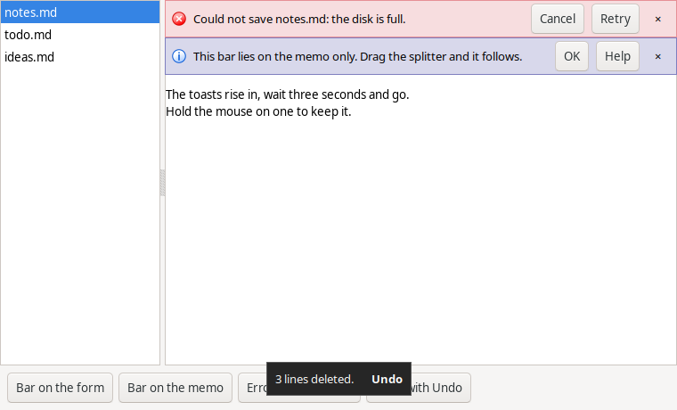

# InfoBarToast

Two non-visual Lazarus components, plain LCL, for Linux, Windows and macOS.

- **TInfoBar** shows a message with MessageDlg's icon and buttons on a strip
  over the top or bottom edge of the form or of a control. It is not modal.
- **TToast** shows a short message near the bottom of the form for a few
  seconds, with an optional action button such as Undo.



## TInfoBar

```pascal
InfoBar1.Show('Load the new version of notes.md?', mtConfirmation, [mbYes, mbNo]);

// QuestionDlg style, for your own captions
InfoBar1.ShowQuestion('notes.md was changed by another program.', mtWarning,
  [mrYes, '&Reload', mrNo, '&Keep mine']);
```

`OnAnswer` receives the `ModalResult` that MessageDlg would have returned.
A button click hides the bar, except Help, which passes `mrNone` and leaves
it up. The close button passes `mrClose`.

`Control` is the control the bar is placed on; leave it empty for the form.
The bar gets that control's width and moves with it when the window or a
splitter moves. `Edge` is `ieTop` or `ieBottom`. While the bar is shown it
covers that edge of the control; other controls are not moved.

## TToast

```pascal
Toast1.Show('Saved.');
Toast1.Show('3 lines deleted.', 'Undo');   // OnAction runs if Undo is clicked
```

It hides after `Duration` milliseconds (default 3000); the timer is paused
while the mouse is over it. A click hides it. For desktop notifications
outside the window, use `TPopupNotifier`.

## Install

Open `infobartoast.lpk` in Lazarus, compile and install. Both components go
on the **LazControls** tab. `demo/` is the program in the picture; `tests/`
has the automated test, run on all three systems.

Tested on Linux (GTK3), Windows 10 and macOS 15, with Lazarus 4.8 and
FPC 3.2.4 as well as the development versions.

## License

[0BSD](LICENSE)
